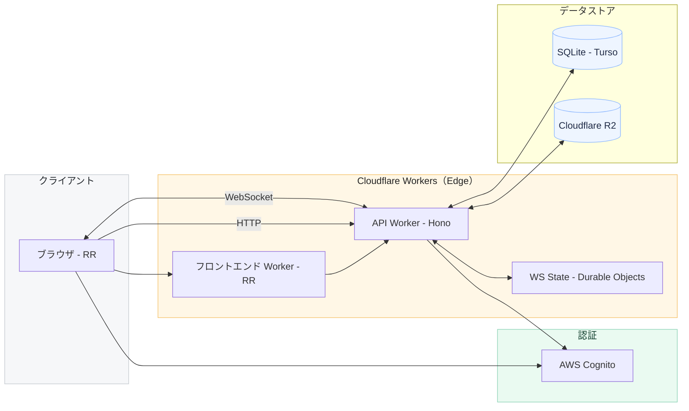

# アーキテクチャ

- サーバー: Cloudflare Workers / Hono
  - Websocket状態保持: Durable Objects
- クライアント: Cloudflare Workers / React Router
- DB: SQLite
  - 本番/STG/Local: Turso
  - Test:
    - E2E: Turso `omojan-main-e2e`
    - Unit: `local.db`ローカルファイル
- 認証: AWS Cognito(LINE Login / OIDC)
- オブジェクトストレージ: Cloudflare R2

