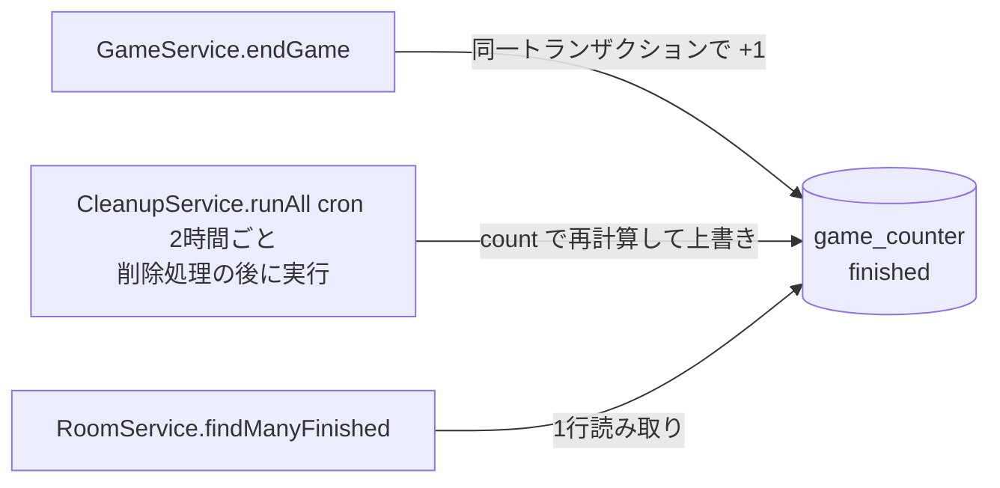

# 終了済みゲーム件数のカウンターテーブル化

## 目的

終了済み一覧の総件数取得（`count()`）による Rows Read を、累計ゲーム数に依存しない定数コストにする。
件数はゲーム終了の処理と同一トランザクションで加算する。不具合によるずれは定期的な Cleanup で再計算で反映・修復する。finished のゲームの削除は実質 Cleanup 内でのみ行われるためカウンターの更新はこちらの再計算に委ねる。

## 背景

- `RoomService.findManyFinished` は一覧取得のたびに `SELECT count(*) FROM game WHERE status = 'finished'` を実行しており、finished のゲーム数ぶん（G 行）の Rows Read が発生する
  - SQLite はテーブルの件数をメタデータとして持たないため、`count()` は条件に一致する行（インデックスのエントリ）をすべて走査する
- 呼び出し元は以下で、いずれも SSR で1回、画面表示後の SWR 再取得で1回、さらにタブに戻るたび（`revalidateOnFocus` が既定の true）に1回実行される
  - トップページ（終了済み5件の表示。総件数は**使用していない**）
  - 終了済み一覧 `/room/finished`（ページ数の表示に使用）
- 月間の Rows Read は G と PV の積で増加し続け、G = 100,000 で無料枠を超える試算となる（「コスト試算」参照）

## アーキテクチャ



- アプリケーションで件数を更新するのは `endGame` のみとし、finished への更新と同一トランザクションで加算する
- finished のゲームの削除は実質 Cleanup 内でのみ行われる。削除のたびに減算はせず、Cleanup 後に行う再計算で件数を合わせる
- この再計算は Cleanup の実行ごとに行われるため、アプリケーションの更新漏れによるずれの修復も兼ねる

## 仕様

### 実装する仕様

#### カウンターテーブル

| テーブル       | 列       | 型      | 制約        | 説明                               |
| -------------- | -------- | ------- | ----------- | ---------------------------------- |
| `game_counter` | `status` | TEXT    | PRIMARY KEY | 集計対象のステータス（`finished`） |
|                | `count`  | INTEGER | NOT NULL    | 該当ステータスのゲーム数           |

- 今回の集計対象は `finished` のみ。`status` を主キーにしておき、必要になれば他のステータスも同じテーブルで扱えるようにする

#### 件数を更新する箇所

finished の件数が変わりうる処理と、その対応は以下のとおり。

| 処理                                                | 件数の変化                 | 対応                                                                                                                                                                                                                 |
| --------------------------------------------------- | -------------------------- | -------------------------------------------------------------------------------------------------------------------------------------------------------------------------------------------------------------------- |
| `GameService.endGame`                               | +1                         | 同一トランザクションで加算する（finished になる唯一の経路）                                                                                                                                                          |
| `CleanupService.deleteRoomsWithInsufficientPlayers` | finished の削除件数ぶん -1 | 個別には減算しない。対象が `status != 'waiting'` のため finished も削除されうるが、同じ Cleanup 後の再計算で件数を合わせる                                                                                           |
| `GameService.deleteGame`                            | 実質なし                   | 対応しない。`GameDurableObject.handleGameAbort`（進行中の処理の失敗時）からのみ呼ばれ、正常終了（`handleGameEnd`）の後には呼ばれないため、削除対象は active のみ。万一 finished を削除しても次回の再計算で修復される |

以下は削除対象が waiting / active のみのため、件数に影響しない。

- `CleanupService.deleteStaleWaitingRooms` / `deleteStaleActiveRooms`
- `MatchingDurableObject` の部屋削除

##### 二重加算の防止

`endGame` は「finished でないゲームを finished に更新できた場合のみ」加算する。
同一ゲームに対して複数回呼ばれても、2回目以降は更新対象が0件になるため加算されない。

#### 件数の取得

`findManyFinished` の `userId` 指定なし（絞り込みなし）の場合、`count()` の代わりに `game_counter` から取得する。

- `userId` 指定あり（ユーザーページ）は対象外とし、既存の `count()` を維持する
  - ユーザーが参加したゲームのみを数えるため、カウンターでは代替できない
  - 現状の実行計画では finished のゲームを全件走査するため、件数・一覧とも1回あたり最大 G 行を読む（「既知でオープンな問題」参照）。ユーザーページはほぼ使われていないため許容する

#### 定期的な再計算

`CleanupService.runAll` に、件数を再計算してカウンターを更新する処理を追加する。

- 削除による件数の減少を反映するため、`runAll` の**最後**（すべての削除処理の後）に実行する
- 途中の削除処理が例外で失敗しても、それまでに成功した削除を反映できるよう `finally` で実行する
- 削除から再計算までの間（同一 cron 実行内）は件数が実際より多くなるが、短時間のため許容する
- finished のゲーム数の集計とカウンターの更新は、間にゲームが終了しても件数がずれないよう不可分に行う（例: 集計をサブクエリとした単一の UPDATE 文）
- 更新前の値と比較し、差分があった場合はログに出力する（更新漏れの検知に使う）

#### 見送る対応

| 候補                                                     | 見送り理由                                                                                                                                                                                                                                                             |
| -------------------------------------------------------- | ---------------------------------------------------------------------------------------------------------------------------------------------------------------------------------------------------------------------------------------------------------------------- |
| SQLite のトリガーで件数を更新                            | 更新漏れは起きないが、drizzle の管理外でマイグレーションの手書きが必要、`drizzle-kit push` では作成されない、`game` テーブルの再作成時に黙って削除されるなど運用上の懸念が大きい。個別に更新する箇所は `endGame` の1つのみで、ずれは定期的な再計算で修復できるため不要 |
| トップページでは件数を取得しない（API にオプション追加） | カウンター化により件数取得は1行の Read になり、削減効果が小さい。API の引数が増えるため今回は行わない                                                                                                                                                                  |
| 件数に上限を付けて数える（`LIMIT 1001` のサブクエリ）    | コストに上限は付くが、1,000件を超えると正確な総ページ数を表示できなくなる                                                                                                                                                                                              |
| Cache API / KV による件数のキャッシュ                    | 件数が古くなるうえ、DB 外の仕組みが増える                                                                                                                                                                                                                              |

### 既存のものとの相違点

- 絞り込みなしの終了済み一覧の `meta.total` / `meta.totalPages` を `game_counter` から算出する。値は従来と同一
- `endGame` は既に finished のゲームを更新しなくなる（`updated_at` も更新されない）。終了済み一覧は `updated_at` を終了日時として表示・並び替えに使っているため、2回目の呼び出しで終了日時が変わらなくなる点はむしろ正しい挙動になる
- `CleanupService.runAll` の最後に件数の再計算が追加される

### 関連する仕様

- DB スキーマ変更・マイグレーションの手順: `docs/db.md`
- DB インデックス追加: `docs/design-docs/db-index.md`

## 実装

### 処理フロー

1. `packages/db/src/schemas/` に `gameCounterTable` を追加し、`pnpm run db:changed --filter @repo/db` でマイグレーションを生成・ローカル適用する
   - 生成されたマイグレーションに初期値の投入 SQL を追記する（`docs/db.md` のスキーマ変更フロー手順4）
   ```sql
   INSERT INTO `game_counter` (`status`, `count`)
   SELECT 'finished', count(*) FROM `game` WHERE `status` = 'finished';
   ```
2. `GameService.endGame` を、finished への更新と件数の加算を同一トランザクションで行うよう変更する
3. `RoomService.findManyFinished` の件数取得を、`userId` 指定なしの場合のみ `game_counter` からの取得に変更する
4. `CleanupService.runAll` の最後に、`finally` で件数の再計算処理を追加する
5. 内部ドキュメント（`docs/db.md`）に、件数の更新ルールを追記する
   - finished にする / finished ゲームを操作する処理を追加する場合は、同一トランザクションで `game_counter` を更新すること
   - finished のゲームの削除は、Cleanup の再計算で件数を合わせるため個別の更新は不要であること
   - 更新を忘れても定期的な再計算で最大2時間以内に修復され、差分ログで検知できること
6. STG → 本番の順で通常フローで適用する
   - マイグレーション適用から新しいコードのデプロイまでの間に終了したゲームは加算されないが、次回の再計算（最大2時間後）で修復される

### コスト試算

| 処理               | 頻度                         | 変更前 | 変更後                                      |
| ------------------ | ---------------------------- | ------ | ------------------------------------------- |
| 件数取得（Read）   | 一覧取得ごと                 | G 行   | 1 行                                        |
| 件数更新（Write）  | ゲーム終了ごと               | 0      | 1 行                                        |
| 定期再計算（Read） | 12 回 / 日（cron 2時間ごと） | 0      | G 行（`game_status_updated_at_idx` を走査） |

月間の Rows Read（仮定: トップページ 30,000 PV、一覧ページ 3,000 PV、月間 3,000 ゲーム）:

変更前は G × (トップページ PV × 約2 ＋ 一覧ページ PV × 約2)。

| G       | 変更前                                 | 変更後                                              |
| ------- | -------------------------------------- | --------------------------------------------------- |
| 10,000  | 約 0.66B / 月（無料枠 2.5B の約 1/4）  | 約 3.7M / 月（件数取得 約 0.07M ＋ 再計算 約 3.6M） |
| 100,000 | 約 6.6B / 月（無料枠超過、約 $4 / 月） | 約 36M / 月（件数取得 約 0.07M ＋ 再計算 約 36M）   |

- 再計算は G × 12 回 × 30 日。G に比例するが PV には依存しない
- Write: 約 3,000 行 / 月の増加（無料枠に対して無視できる）

### 作成物の使用例

スキーマ:

```ts
export const gameCounterTable = sqliteTable("game_counter", {
  count: integer("count").notNull(),
  status: text("status", { enum: ["finished"] }).primaryKey(),
});
```

`endGame`（二重加算の防止）:

```ts
async endGame({ gameId }: { gameId: GameId }): Promise<void> {
	await this.db.transaction(async (tx) => {
		const updated = await tx
			.update(gameTable)
			.set({ status: "finished" })
			.where(and(eq(gameTable.id, gameId), ne(gameTable.status, "finished")))
			.returning({ id: gameTable.id });

		// 既に finished の場合は加算しない
		if (updated.length === 0) return;

		await tx
			.update(gameCounterTable)
			.set({ count: sql`${gameCounterTable.count} + 1` })
			.where(eq(gameCounterTable.status, "finished"));
	});
}
```

## セキュリティやプライバシーについての考察

なし（件数のみを扱い、個人に紐づく情報は含まない）。

## 既知でオープンな問題

- **新しい処理での更新漏れ**
  - 将来ゲームを finished にする処理を追加した際に、件数の加算を忘れる可能性がある
  - `deleteGame` が将来 finished のゲームを削除するよう変わった場合も、次回の再計算までは件数が実際より多くなる
  - その場合も定期的な再計算で最大2時間以内に修復され、差分ログで検知できる
  - 件数のずれは一覧の総件数・総ページ数の表示に影響するのみで致命的ではないため、許容する
  - 更新ルールを `docs/db.md` に明記して周知する（処理フロー手順5）
- **`countByStatus`（`/rooms/count`）の扱い**
  - 現状フロントエンドからは `active` でのみ呼ばれており、`finished` の件数取得には使われていないため対象外とする
  - 将来 `finished` で使う場合は `game_counter` から取得するよう変更する
- **`userId` 指定ありの `findManyFinished` は G 行を読む**
  - ローカルの `EXPLAIN QUERY PLAN` で、件数・一覧のいずれも `game_status_updated_at_idx` で finished を全件走査し、`player`（`player_user_id_idx`）のサブクエリは照合にのみ使われることを確認した
  - ユーザーページ・対戦履歴はほぼ使われていないため、今回は対応しない
  - 利用が増えた場合は、`UserService.calculateStats` と同様に `player` を起点に `game` を JOIN する形へ書き換えれば、参加ゲーム数 × 約2 の Read で済む（ユーザー別のカウンターテーブルは一覧の走査を解消できず、更新箇所も増えるため採用しない）

## テスト計画、モニタープラン

### テスト

- `endGame`
  - waiting / active のゲームを終了すると件数が +1 されること
  - 既に finished のゲームに対して呼んでも件数が変わらないこと
- `CleanupService.runAll`
  - `deleteRoomsWithInsufficientPlayers` で finished のゲームが削除された後、`runAll` 完了時点で件数が正しい値になっていること
  - 途中の削除処理が例外で失敗した場合も、再計算が実行されること
- `findManyFinished`
  - 絞り込みなしの `meta.total` / `meta.totalPages` が従来の `count()` の結果と一致すること
  - `userId` 指定ありは従来どおり `count()` の結果を返すこと
- 定期再計算
  - 件数を意図的にずらした状態で実行すると、正しい件数に上書きされ差分がログ出力されること
- ページネーションの動作に問題がないこと

### モニタリング

- デプロイ後、Turso ダッシュボードで Rows Read を前後比較する（「Rows Read ÷ PV」で比較する）
  - インデックス追加（`docs/design-docs/db-index.md`）と同時期にリリースすると効果を切り分けられないため、リリース日をずらすか、どちらの効果かを区別して記録する

### ロールバック

- `findManyFinished` の件数取得を `count()` に戻すだけで、表示は元に戻る（件数の更新処理と `game_counter` は残っていても影響しない）
- 完全に戻す場合は、件数の更新処理を削除し、`game_counter` を DROP するマイグレーションを適用する

## 参考文献

- [Turso Pricing](https://turso.tech/pricing)

## レポジトリ

- スキーマ・マイグレーション: `packages/db/src/schemas/`, `packages/db/src/migrations/`
- 件数の加算: `packages/api/src/application/game/GameService.ts`
- 件数の取得: `packages/api/src/application/room/RoomService.ts`
- 定期再計算: `packages/api/src/application/cleanup/CleanupService.ts`
- 削除の呼び出し元: `packages/api/src/application/game/GameDurableObject.ts`（`handleGameAbort`）
- 呼び出し元: `packages/web/app/routes/_index/route.tsx`, `packages/web/app/routes/room/finished/route.tsx`

## Docの編集の履歴

| 編集日     | 編集者       | 内容     |
| ---------- | ------------ | -------- |
| 2026-10-08 | sendo-kakeru | 初版作成 |
