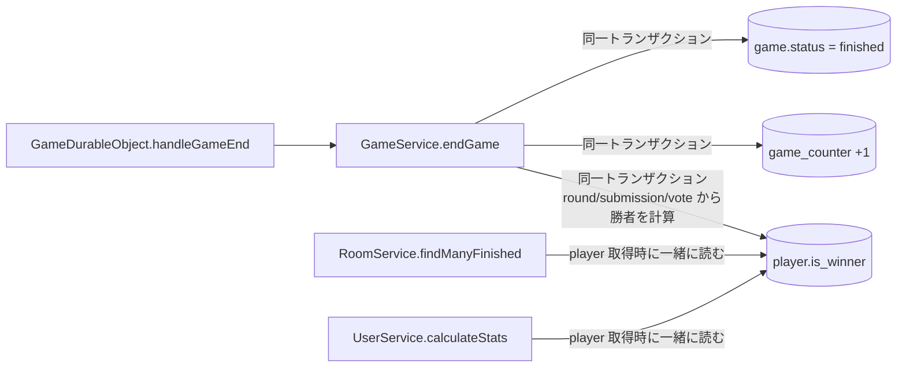

# ゲーム勝者の事前計算（`player.is_winner`）

## 目的

終了済みゲームの勝者を、ゲーム終了時に1回だけ計算して DB に保持する。
表示のたびにラウンド・提出・投票を全件取得して勝者を再計算する処理をなくし、Rows Read をゲームの中身（ラウンド数・投票数）に依存しない量にする。

## 背景

ゲームの勝者は「ラウンド勝利数が最大のプレイヤー（同率の場合は複数人）」であり、現状は表示のたびに以下を取得して計算している。

| 呼び出し元                                                | 画面                                                                | 勝者計算のために読む行（1ゲームあたり）          |
| --------------------------------------------------------- | ------------------------------------------------------------------- | ------------------------------------------------ |
| `RoomService.findManyFinished` → `calculateGameWinnerIds` | トップページ（5件）、終了済み一覧（20件）、ユーザーページの対戦履歴 | round 4 ＋ submission 16 ＋ vote 約16 ＝ 約36 行 |
| `UserService.calculateStats`                              | ユーザーページ（勝利数）                                            | 参加した終了済みゲームすべてについて 約36 行     |
| `GameService.getResult`                                   | 終了ゲーム詳細（結果画面）                                          | 約36 行（ただしラウンドごとの表示にも使う）      |

- 一覧はゲームカードごと（1ゲームごと）に約36行を読むため、トップページ1回で約180行、終了済み一覧1回で約720行になる
- SSR ＋ SWR 再取得（`revalidateOnFocus`）で1PVあたり約2回実行される
- ユーザーページの勝利数は参加ゲーム数に比例して増え続ける
- 同じ勝者計算ロジック（ラウンド勝者 → 勝利数集計 → 最大値の抽出）が `RoomService` / `UserService` / `GameService` の3箇所に重複している

## アーキテクチャ



- 勝者の計算はゲームが finished になる唯一の経路である `GameService.endGame` でのみ行う
- 表示側（一覧・ユーザー統計）は、もともと取得している `player` の行から `is_winner` を読むだけにする

## 仕様

### カラムの追加先の検討

勝者は複数人になりうる（同率1位）ことが前提。

| 案                                                        | 複数勝者                          | 読み取り                                                                    | 書き込み                 | 評価                                                                                                                                                                                                    |
| --------------------------------------------------------- | --------------------------------- | --------------------------------------------------------------------------- | ------------------------ | ------------------------------------------------------------------------------------------------------------------------------------------------------------------------------------------------------- |
| **A. `player.is_winner`（boolean）** ✅ 採用              | 自然に表現できる（複数行が true） | 一覧・ユーザー統計はもともと `player` を読んでいるため **追加の Read なし** | 勝者の人数ぶん（1〜4行） | 正規化されており、FK・`onDelete: cascade` もそのまま効く。ユーザーの勝利数も `player` の絞り込みだけで数えられる                                                                                        |
| B. `game.winner_player_id`（text, FK）                    | **表現できない**                  | -                                                                           | 1行                      | 同率1位を扱えないため不可                                                                                                                                                                               |
| C. `game.winner_player_ids`（JSON 配列の text）           | 表現できる                        | `game` は一覧で読んでいるため追加なし                                       | 1行                      | FK 制約が効かず、プレイヤー削除時に不整合が残る。ユーザー統計で「このユーザーが勝ったか」を判定するには JSON を展開する必要があり、SQL で数えにくい。drizzle の型・バリデーションも自前で持つ必要がある |
| D. 勝者テーブル `game_winner (game_id, player_id)` を新設 | 表現できる                        | 一覧・統計で JOIN または別クエリが必要（勝者人数ぶんの Read が増える）      | 勝者の人数ぶん           | 正規化はされるが、`player` に1列足すのと比べてテーブル・クエリ・マイグレーションが増えるだけでメリットがない                                                                                            |

→ **A. `player` テーブルに `is_winner` を追加する**。

- 「勝者かどうか」はゲームに参加したプレイヤー1人1人の属性であり、`player`（ゲームとユーザーの中間エンティティ）に置くのが最も素直
- 一覧（`getPlayersGroupedByGameId`）・ユーザー統計（`calculateStats`）はどちらも既に `player` を読んでいるため、選択列を1つ増やすだけで勝者が分かる
- API のレスポンス（`players[].isWinner`）とも1対1に対応する

#### 勝利数（`win_count`）も保持するか

保持しない。

- 勝者の判定に必要なのは `is_winner` のみで、現状の一覧・ユーザー統計で勝利数（ラウンド勝利数）は表示していない
- 結果画面（`getResult`）は勝者の `winCount` を表示するが、ラウンドごとの勝者表示のために round / submission / vote を結局読むため、`win_count` を保持しても Read はほぼ減らない（「既知でオープンな問題」参照）
- 将来、一覧などで勝利数を表示したくなった時点で追加を検討する

#### ラウンドごとの勝者も保持するか

保持しない。

- ラウンドごとの勝者を使うのは結果画面（`getResult`）のみ
- 結果画面は提出テキストの表示のために round / submission / player_card / round_theme を読む必要があり、ラウンドの勝者を保持しても省けるのは vote の読み取り（1ゲームあたり16行）のみ
- 保持する場合は投票の確定ごとの書き込みと、保存値・投票データの2つの出どころの管理が増え、効果に見合わない
- 結果画面の Read を減らす必要が出た場合は、ラウンド結果ごと保存する（スナップショット化）設計と合わせて検討する

### 実装する仕様

#### カラム

| テーブル | 列          | 型                 | 制約               | 説明                                       |
| -------- | ----------- | ------------------ | ------------------ | ------------------------------------------ |
| `player` | `is_winner` | INTEGER（boolean） | NOT NULL DEFAULT 0 | ゲーム終了時点でのゲーム全体の勝者かどうか |

- ゲームが finished になるまでは常に `false`。値が意味を持つのは finished のゲームのみ
- `false` のまま finished にならずに削除されるゲーム（waiting / active の削除）には影響しない
- インデックスは追加しない（「コスト試算」参照。`player_user_id_idx` / `player_game_id_idx` で絞り込んだ後の行で判定するため不要）

#### 勝者の定義

現状の `RoomService.calculateGameWinnerIds` / `UserService.calculateStats` と同じ定義とする。

1. ラウンドごとに、得票数が最大（かつ1票以上）の提出をしたプレイヤーをラウンド勝者とする（同率は複数人）
   - `GameService.calculateWinnersAndVoteCountsFromVotes` をそのまま使う
2. プレイヤーごとにラウンド勝利数を数える
3. ラウンド勝利数が最大（かつ1以上）のプレイヤーをゲームの勝者とする（同率は複数人）
   - 全ラウンドで誰も票を得ていない場合は勝者なし（全員 `false`）

#### 計算関数の構成

勝者のルールを1箇所にまとめ、`endGame`（保存）と `getResult`（表示）で同じ関数を使う。

| 関数                                                       | 種別                 | 内容                                                                                                                | 利用箇所               |
| ---------------------------------------------------------- | -------------------- | ------------------------------------------------------------------------------------------------------------------- | ---------------------- |
| `GameService.calculateWinnersAndVoteCountsFromVotes`       | static（既存）       | 1ラウンドの submission / vote からラウンド勝者を求める（手順1）                                                     | 下記2関数、`getResult` |
| `GameService.calculateWinnersAndWinCountsFromRoundWinners` | static（新規・純粋） | ラウンドごとの勝者 ID からプレイヤーごとの勝利数と、ゲームの勝者 ID を求める（手順2〜3）。勝利数が0の場合は勝者なし | `endGame`、`getResult` |
| `GameService.calculateGameWinners`                         | private（新規）      | 1ゲームの submission / vote を読み、上記2関数でゲームの勝者 ID を求める       | `endGame`              |

- `RoomService.calculateGameWinnerIds` と `UserService.calculateStats` の勝者計算は削除する
  - 複数ゲームをまとめて計算する構造で `RoomService` に置かれているため、流用せず `GameService` に1ゲーム単位の関数として作り直す
- `getResult` は `calculateWinnersAndWinCountsFromRoundWinners` の結果を使う。勝者が0人の場合は一覧・ユーザー統計と同様に勝者なしとする（#1449 で揃えた）

#### 書き込むタイミング

`GameService.endGame` の、finished への更新・`game_counter` の加算と**同一トランザクション**で行う。

- 勝者の計算（round / submission / vote の読み取り）はトランザクションの**前**に行う
  - 最終ラウンドの投票後はデータが変わらないため、トランザクション外で読んでも結果は同じ
  - トランザクション内を書き込みのみにし、書き込みロックを保持する時間と、途中で失敗する箇所を減らす
- finished への更新ができた場合（`updated.length > 0`）のみ `is_winner` を更新する（`game_counter` と同じく二重実行の防止）
- 勝者が0人の場合は更新しない

##### 失敗時の再試行

`GameDurableObject.handleGameEnd` で `endGame` を `pRetry` で再試行する（提出・投票と同じ扱い）。

- `endGame` は二重に実行しても finished への更新・加算・勝者の更新が1回分しか反映されないため、再試行しても安全
- 再試行しても失敗した場合は従来どおりログを出力して終了処理を続ける。ゲームは active のまま残り、Cleanup で削除される

##### 勝者を DB から再計算する理由（Durable Object のメモリ上の値を渡さない理由）

`GameDurableObject` はラウンドごとに `winCount` をメモリ上で数えているため、`endGame` に勝者 ID を渡す方法もある。今回は採用しない。

- DB の投票データを唯一の正とし、表示側で行っていた計算と同じロジック・同じデータで求められる
- Durable Object の状態（再起動・ハイバネーション時の復元など）に勝者の正しさが依存しない
- 追加の Read は1ゲームにつき約36行・ゲーム終了時の1回のみで、月間 3,000 ゲームでも約 0.1M 行と無視できる

#### 読み取り側の変更

| 呼び出し元                     | 変更内容                                                                                                                                                                                           |
| ------------------------------ | -------------------------------------------------------------------------------------------------------------------------------------------------------------------------------------------------- |
| `RoomService.findManyFinished` | `getPlayersGroupedByGameId` で `playerTable.isWinner` を選択し、`isWinner` に使う。`calculateGameWinnerIds` を削除する                                                                             |
| `UserService.calculateStats`   | 参加した finished のゲームの `player` 取得時に `is_winner` も選択し、`true` の件数を勝利数とする（SQL の `sum` / `count` で1クエリにしてもよい）。round / submission / vote の取得と計算を削除する |
| `GameService.getResult`        | 読み取りは変更しない。勝利数の集計と勝者の抽出を `calculateWinnersAndWinCountsFromRoundWinners` に置き換える（勝者が0人の場合に全員を返す挙動は維持）                                              |

API レスポンスの形は変更しないため、フロントエンド（`packages/web`）の変更は不要。

#### 既存データのバックフィル

マイグレーション生成後、既存の finished のゲームについて `is_winner` を計算する SQL を手動で追記する（`docs/db.md` のスキーマ変更フロー手順4）。

```sql
-- ラウンドごとの勝者（得票数が最大かつ1票以上）からゲームごとの勝利数を数え、最大のプレイヤーを勝者にする
WITH submission_votes AS (
  SELECT s.`id` AS submission_id, s.`player_id`, s.`round_id`, count(v.`id`) AS vote_count
  FROM `submission` s
  LEFT JOIN `vote` v ON v.`submission_id` = s.`id`
  GROUP BY s.`id`
),
round_max AS (
  SELECT `round_id`, max(vote_count) AS max_vote_count
  FROM submission_votes
  GROUP BY `round_id`
),
player_win_counts AS (
  SELECT sv.`player_id`, count(*) AS win_count
  FROM submission_votes sv
  JOIN round_max rm ON rm.`round_id` = sv.`round_id`
  WHERE rm.max_vote_count > 0 AND sv.vote_count = rm.max_vote_count
  GROUP BY sv.`player_id`
),
game_max AS (
  SELECT p.`game_id`, max(pwc.win_count) AS max_win_count
  FROM player_win_counts pwc
  JOIN `player` p ON p.`id` = pwc.`player_id`
  GROUP BY p.`game_id`
)
UPDATE `player`
SET `is_winner` = 1
WHERE `id` IN (
  SELECT pwc.`player_id`
  FROM player_win_counts pwc
  JOIN `player` p ON p.`id` = pwc.`player_id`
  JOIN `game_max` gm ON gm.`game_id` = p.`game_id`
  JOIN `game` g ON g.`id` = p.`game_id`
  WHERE g.`status` = 'finished' AND pwc.win_count = gm.max_win_count
);
```

- 何度実行しても同じ結果になる（冪等）ため、デプロイ後に手動で再実行して取りこぼしを補える
- バックフィル1回の Read は submission・vote・player の全件程度（数十万行規模）で、1回限りのため許容する
- ローカル DB で、バックフィル結果が既存の `calculateGameWinnerIds` の結果と全ゲームで一致することを確認する
  - 設計時点で `packages/db/src/local.db` のコピーに対して実行し、finished の 164 ゲーム（勝者 243 人。同率1位を含む）で既存ロジックと全件一致し、2回実行しても結果が変わらないことを確認済み

### 既存のものとの相違点

- 一覧・ユーザー統計の勝者は、表示時の再計算ではなくゲーム終了時点で保存した値になる
  - 投票データは終了後に変更されないため、表示結果は従来と同一
- `endGame` が、トランザクション前の勝者の計算と、トランザクション内の `player` の更新のぶん重くなる（ゲーム終了時の1回のみ）
- `handleGameEnd` で `endGame` が失敗した場合に再試行するようになる
- 勝者計算ロジックの重複（3箇所）が解消され、勝者のルールは `GameService.calculateWinnersAndWinCountsFromRoundWinners` の1箇所になる
  - `RoomService` / `UserService` の計算は削除し、`endGame` と `getResult` が同じ関数を使う

### 関連する仕様

- DB スキーマ変更・マイグレーションの手順: `docs/db.md`
- 終了済みゲーム件数のカウンター（`endGame` の同一トランザクション更新）: `docs/design-docs/finished-game-counter.md`
- DB インデックス追加: `docs/design-docs/db-index.md`

## 実装

### 実装フロー

1. `packages/db/src/schemas/player.ts` に `isWinner: integer("is_winner", { mode: "boolean" }).notNull().default(false)` を追加し、`pnpm run db:changed --filter @repo/db` でマイグレーションを生成・ローカル適用する
   - 生成されたマイグレーションに、上記のバックフィル SQL を `--> statement-breakpoint` 区切りで追記する
2. `GameService` に `calculateWinnersAndWinCountsFromRoundWinners`（純粋関数）と `calculateGameWinners` を追加し、`getResult` の勝利数の集計と勝者の抽出を `calculateWinnersAndWinCountsFromRoundWinners` に置き換える（勝者が0人の場合に全員を返す挙動は維持）
3. `GameService.endGame` で、トランザクションの前に勝者を計算し、finished に更新できた場合のみ同一トランザクションで勝者の `player.is_winner` を `true` に更新する
4. `GameDurableObject.handleGameEnd` で `endGame` を `pRetry` で再試行する
5. `RoomService.findManyFinished` を `player.is_winner` を使う形に変更し、`calculateGameWinnerIds` を削除する
6. `UserService.calculateStats` を `player.is_winner` を使う形に変更し、勝者計算を削除する
7. `docs/db.md` に「ゲームを finished にする処理を追加する場合は `player.is_winner` も同一トランザクションで更新すること」を追記する
8. STG → 本番の順で通常フローで適用する
   - マイグレーション適用から新しいコードのデプロイまでの間に終了したゲームは `is_winner` が更新されない
   - デプロイ完了後にバックフィル SQL を手動で再実行して補う（冪等）

### コスト試算

| 処理                   | 頻度                   | 変更前                 | 変更後                                           |
| ---------------------- | ---------------------- | ---------------------- | ------------------------------------------------ |
| トップページ（5件）    | 1 PV あたり約2回       | 約 180 行 / 回         | 0 行 / 回（追加なし）                            |
| 終了済み一覧（20件）   | 1 PV あたり約2回       | 約 720 行 / 回         | 0 行 / 回                                        |
| ユーザー統計           | ユーザーページ表示ごと | 参加ゲーム数 × 約36 行 | 0 行（`player` の取得で判定）                    |
| ゲーム終了時の勝者計算 | ゲーム終了ごと         | 0                      | 約36 行の Read ＋ 勝者人数ぶん（1〜4行）の Write |

※ 勝者計算のためだけに読んでいた round / submission / vote の行数。round 4 ＋ submission 16 ＋ vote 16 で概算。

月間の Rows Read（仮定: トップページ 30,000 PV、一覧ページ 3,000 PV、月間 3,000 ゲーム。`finished-game-counter.md` と同じ仮定）:

| 処理               | 変更前        | 変更後       |
| ------------------ | ------------- | ------------ |
| トップページ       | 約 10.8M / 月 | 0            |
| 終了済み一覧       | 約 4.3M / 月  | 0            |
| ゲーム終了時の計算 | 0             | 約 0.1M / 月 |
| 合計               | 約 15M / 月   | 約 0.1M / 月 |

- 無料枠（2.5B）に対しては現状でも小さく、#1411 のインデックス追加後は緊急性は低い。PV が1〜2桁増えたタイミングで効いてくる
- Write は月間 約 3,000〜12,000 行の増加で、無料枠に対して無視できる

### 作成物の使用例

スキーマ:

```ts
export const playerTable = sqliteTable(
  "player",
  {
    // ...
    /** ゲーム全体の勝者かどうか（ゲーム終了時に確定。同率1位は複数人 true） */
    isWinner: integer("is_winner", { mode: "boolean" })
      .notNull()
      .default(false),
    // ...
  },
  // ...
);
```

`endGame`:

```ts
async endGame({ gameId }: { gameId: GameId }): Promise<void> {
	// 最終ラウンドの投票後はデータが変わらないため、トランザクションの前に計算する
	const winnerPlayerIds = await this.calculateGameWinners({
		gameId,
	});

	await this.db.transaction(async (tx) => {
		const updated = await tx
			.update(gameTable)
			.set({ status: "finished" })
			.where(and(eq(gameTable.id, gameId), ne(gameTable.status, "finished")))
			.returning({ id: gameTable.id });

		// 既に finished の場合は加算・勝者の更新をしない
		if (updated.length === 0) return;

		await tx
			.update(gameCounterTable)
			.set({ count: sql`${gameCounterTable.count} + 1` })
			.where(eq(gameCounterTable.status, "finished"));

		if (winnerPlayerIds.length === 0) return;

		await tx
			.update(playerTable)
			.set({ isWinner: true })
			.where(inArray(playerTable.id, winnerPlayerIds));
	});
}
```

`calculateWinnersAndWinCountsFromRoundWinners`（純粋関数）:

```ts
static calculateWinnersAndWinCountsFromRoundWinners({
	winnerPlayerIdsPerRound,
}: {
	winnerPlayerIdsPerRound: PlayerId[][];
}): {
	winCountByPlayer: Map<PlayerId, number>;
	winnerPlayerIds: PlayerId[];
} {
	const winCountByPlayer = new Map<PlayerId, number>();
	for (const roundWinnerPlayerIds of winnerPlayerIdsPerRound) {
		for (const playerId of roundWinnerPlayerIds) {
			winCountByPlayer.set(playerId, (winCountByPlayer.get(playerId) ?? 0) + 1);
		}
	}

	const maxWinCount = Math.max(...winCountByPlayer.values(), 0);
	// 勝利数が0の場合は勝者なし
	if (maxWinCount === 0) return { winCountByPlayer, winnerPlayerIds: [] };

	return {
		winCountByPlayer,
		winnerPlayerIds: [...winCountByPlayer.entries()]
			.filter(([, winCount]) => winCount === maxWinCount)
			.map(([playerId]) => playerId),
	};
}
```

`getResult`（勝者が0人の場合は勝者なし）:

```ts
const { winCountByPlayer, winnerPlayerIds } =
  GameService.calculateWinnersAndWinCountsFromRoundWinners({
    winnerPlayerIdsPerRound: [...roundWinnersByRoundId.values()],
  });
// NOTE: 一覧・ユーザー統計と同様に、勝者が0人の場合は勝者なしとする
const winners = players
  .filter((player) => winnerPlayerIds.includes(player.id))
  .map((player) => ({
    // ...
    winCount: winCountByPlayer.get(player.id) ?? 0,
  }));
```

`handleGameEnd`（再試行）:

```ts
try {
  await pRetry(
    async () => {
      if (!this.gameId) return;
      await this.gameService.endGame({ gameId: this.gameId });
    },
    { retries: 3 },
  );
} catch (error) {
  console.error("ゲームステータスの更新に失敗しました:", error);
}
```

`findManyFinished`（プレイヤー取得時に一緒に読む）:

```ts
const players = await this.db.select({
  gameId: playerTable.gameId,
  id: playerTable.id,
  image: userTable.image,
  isCpu: playerTable.isCpu,
  isWinner: playerTable.isWinner,
  playerName: playerNameExpression,
  userId: playerTable.userId,
});
// ...
```

`calculateStats`:

```ts
const [stats] = await this.db
  .select({
    playCount: count(),
    winCount: sql<number>`coalesce(sum(${playerTable.isWinner}), 0)`,
  })
  .from(playerTable)
  .innerJoin(gameTable, eq(playerTable.gameId, gameTable.id))
  .where(and(eq(playerTable.userId, userId), eq(gameTable.status, "finished")));
```

## セキュリティやプライバシーについての考察

なし。勝者情報は従来から一覧・結果画面で公開しており、保持方法が変わるだけで公開範囲は変わらない。

## 既知でオープンな問題

- **結果画面（`getResult`）は対象外**
  - ラウンドごとの勝者表示（`rounds[].players[].isWinner`）と提出テキストのために round / submission / vote / player_card を読む必要があり、`is_winner` を使っても Read はほぼ減らない
  - 勝者一覧（`winners`）を `is_winner` から作る変更は可能だが、効果が小さいため今回は行わない。勝者のルールは `calculateWinnersAndWinCountsFromRoundWinners` を共有することで一致させる
  - 結果画面の Read を減らすには、ラウンド結果ごと保存する（スナップショット化）など別の設計が必要
- **結果画面と一覧で「勝者なし」の扱いが異なる（解消済み）**
  - #1449 で `getResult` の分岐を削除し、最大勝利数が 0 の場合は結果画面も勝者なしとした
- **新しく finished にする処理での更新漏れ**
  - `endGame` 以外でゲームを finished にする処理を追加した場合、`is_winner` が更新されない
  - `game_counter` と異なり定期的な再計算は行わない（勝者は終了後に変化しないため、正しく書き込めば修復の必要がない）。必要になればバックフィル SQL を Cleanup に組み込める
  - `docs/db.md` に更新ルールを明記して周知する（処理フロー手順7）
- **`endGame` が失敗した場合**
  - finished への更新・カウンター・勝者は同一トランザクションのため、全て反映されないか全て反映されるかのどちらかになり、「finished だが勝者が未計算」の状態は発生しない
  - 再試行しても失敗したゲームは active のまま残り、Cleanup で削除される（正常に終了できなかったゲームとして扱う）
  - 表示時に勝者が未計算のゲームを検知して計算・更新する方法は採らない。上記のとおり通常は発生せず、全ラウンド無投票（勝者0人が正しい）のゲームと区別できないうえ、読み取り処理に書き込みが混ざるため

## テスト計画、モニタープラン

### テスト

- 勝者計算の純粋関数
  - 単独1位のプレイヤーのみが勝者になること
  - 同率1位が複数いる場合、全員が勝者になること
  - 全ラウンドで票がない場合、勝者が0人になること
- `endGame`
  - 終了後、勝者の `player.is_winner` が `true`、それ以外が `false` になること
  - 同率1位のプレイヤーが全員 `true` になること
  - 既に finished のゲームに対して呼んでも `is_winner` が変わらないこと
- `getResult`
  - `winners` と各プレイヤーの `winCount` が変更前と一致すること
  - 全ラウンドで票がない場合、従来どおり全プレイヤーが `winners` に含まれること
- `handleGameEnd`
  - `endGame` が一時的に失敗しても、再試行で終了処理が反映されること
- `findManyFinished`
  - `players[].isWinner` が `player.is_winner` と一致すること（従来の計算結果と一致すること）
  - round / submission / vote を読まないこと
- `calculateStats`
  - `winCount` が `is_winner = true` かつ finished のゲーム数と一致すること
  - waiting / active のゲームは数えないこと
- バックフィル SQL
  - ローカル DB の全 finished ゲームについて、従来の `calculateGameWinnerIds` と結果が一致すること
  - 2回実行しても結果が変わらないこと

### 本番データでの反映前後の照合

本番の現行ロジックの出力を反映前に保存し、反映後（マイグレーション・デプロイ・バックフィル再実行の完了後）の出力と照合する。データの取得には認証不要の公開 API を使う。

- 照合対象は終了済み一覧（`GET /v1/rooms?status=finished&limit=100&page=N`）とし、全ページを取得してゲームごとの `players[].isWinner` が true の playerId を比較する
  - 一覧は全ての finished のゲームを含むため、`is_winner`（マイグレーションのバックフィル・`endGame` の書き込み）の正しさを全件で確認できる
  - ユーザーの勝利数は同じ `is_winner` を数えるだけのため、一覧が一致すれば一致する。結果画面は勝者の計算を共通関数に置き換えるのみで、既存のテストで担保する
- 取得と照合はスクリプトで行い、リポジトリに残す
- `gameId` をキーに、反映前後の両方に存在するゲームだけを比較する（取得中に終了したゲームによるページのずれを吸収するため）
- 本番 API への負荷を避けるため、リクエストは直列にし間隔を空ける

### モニタリング

- デプロイ後、Turso ダッシュボードで Rows Read を前後比較する（「Rows Read ÷ PV」で比較する）
- 本番適用後、`is_winner = true` のプレイヤーがいない finished のゲームの件数を確認し、取りこぼしがあればバックフィル SQL を再実行する

```sql
SELECT count(*) FROM `game` g
WHERE g.`status` = 'finished'
  AND NOT EXISTS (SELECT 1 FROM `player` p WHERE p.`game_id` = g.`id` AND p.`is_winner` = 1);
```

（全ラウンド無投票のゲームはここに含まれるため、0件にならなくても異常とは限らない）

### ロールバック

- 読み取り側（`findManyFinished` / `calculateStats`）を従来の計算に戻すだけで表示は元に戻る（`is_winner` の列と書き込みは残っていても影響しない）
- 完全に戻す場合は、`endGame` の書き込みを削除し、`is_winner` を DROP するマイグレーションを適用する

## 参考文献

- [Turso Pricing](https://turso.tech/pricing)
- [SQLite: WITH clause](https://www.sqlite.org/lang_with.html)

## レポジトリ

- スキーマ・マイグレーション: `packages/db/src/schemas/player.ts`, `packages/db/src/migrations/`
- 勝者の計算・書き込み: `packages/api/src/application/game/GameService.ts`（`endGame`）
- 呼び出し元: `packages/api/src/application/game/GameDurableObject.ts`（`handleGameEnd`）
- 一覧: `packages/api/src/application/room/RoomService.ts`（`findManyFinished`）
- ユーザー統計: `packages/api/src/application/user/UserService.ts`（`calculateStats`）

## Docの編集の履歴

| 編集日     | 編集者       | 内容     |
| ---------- | ------------ | -------- |
| 2026-10-09 | sendo-kakeru | 初版作成 |
