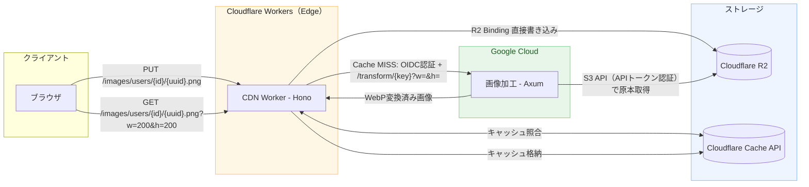
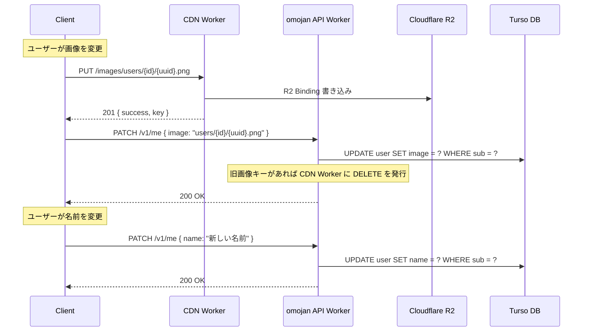

# 画像基盤 デザインドック

## 概要

omojanプロジェクトに汎用的な画像アップロード・加工・配信基盤を導入する。
現在のユースケースはユーザープロフィール画像の編集・表示だが、今後のあらゆる画像用途に対応できる汎用基盤として設計する。

参考実装: [image-processing-delivery-rust](https://github.com/sendo-kakeru/image-processing-delivery-rust)

## アーキテクチャ



## リクエストフロー

### 画像アップロード

```
Client → PUT /images/users/{userId}/{uuid}.png
         Body: バイナリ画像データ
         ↓
CDN Worker
  1. /images/ プレフィックスを除去 → R2キー: users/{userId}/{uuid}.png
  2. キーのバリデーション（パストラバーサル防止）
  3. ファイルサイズチェック（10MB上限）
  4. マジックバイトによるMIME判定（JPEG/PNG/GIF/WebP/AVIF）
  5. R2 Bindingで直接書き込み
         ↓
Response: 201 { success: true, key: "users/{userId}/{uuid}.png" }
```

### 画像配信（リサイズあり）

```
Client → GET /images/users/{userId}/{uuid}.png?w=200&h=200
         ↓
CDN Worker
  1. /images/ プレフィックスを除去 → R2キー: users/{userId}/{uuid}.png
  2. キーのバリデーション
  3. クエリパラメータのバリデーション（w, h）
  3. Cache API 照合（正規化URLをキーに）
     ├─ HIT → キャッシュから返却（X-Cache: HIT）
     └─ MISS ↓
  5. Cloud Run（Image Processor）に転送
     → GET /transform/users/{userId}/{uuid}.png?w=200&h=200
         ↓
Image Processor (Rust / Cloud Run)
  1. キーのバリデーション
  2. R2 から原本画像を S3 API で取得
  3. デコード → リサイズ（Lanczos3） → WebPエンコード
  4. Cache-Control: public, max-age=31536000, immutable で返却
         ↓
CDN Worker
  6. Cache API に格納（waitUntil）
  7. クライアントに返却（X-Cache: MISS）
```

### 画像配信（原本そのまま）

```
Client → GET /images/users/{userId}/{uuid}.png
         （w, h パラメータなし）
         ↓
Image Processor
  → 原本をそのままWebPに変換して返却（リサイズなし）
```

### 画像削除

```
Client → DELETE /images/users/{userId}/{uuid}.png
         ↓
CDN Worker
  1. /images/ プレフィックスを除去 → R2キー: users/{userId}/{uuid}.png
  2. キーのバリデーション
  3. R2 からオブジェクト削除
  4. Cache API からキャッシュパージ
         ↓
Response: 200 { success: true }
```

## コンポーネント設計

### 1. CDN Worker (`packages/cdn/`)

Cloudflare Workers + Hono で構築するエッジキャッシュ・ルーティング層。

| エンドポイント | メソッド | 説明 |
|---|---|---|
| `/images/*` | GET | 画像配信（リサイズ対応） |
| `/images/*` | PUT | 画像アップロード |
| `/images/*` | DELETE | 画像削除 |
| `/health` | GET | ヘルスチェック |

**ドメイン:**
| 環境 | ドメイン |
|---|---|
| production | `cdn.omojan.com` |
| staging | `cdn-stg.omojan.com` |
| dev | `localhost:8686` |

**URL → R2キー変換:**
- URLパスの先頭 `/images/` を除去し、残りをR2キーとして使用
- 例: `/images/users/{id}/{uuid}.png` → R2キー `users/{id}/{uuid}.png`
- 将来 `/videos/*` 等のコンテンツ種別ルート追加を考慮

**主な責務:**
- キーバリデーション（パストラバーサル防止、ホワイトリスト方式: `[a-zA-Z0-9\-_/.]`）
- アップロード時のMIME判定（マジックバイト: JPEG `FF D8 FF`, PNG `89 50 4E 47`, GIF `47 49 46`, WebP `52 49 46 46...57 45 42 50`, AVIF `...66 74 79 70 61 76 69 66`）
- Cache API によるエッジキャッシュ管理（クエリパラメータをソートして正規化）
- Cloud Run へのプロキシ（SSRF防止: オリジンURLの検証）
- R2 Binding による直接読み書き（アップロード・削除）
- CORS設定（`WEB_URL`環境変数からの動的オリジン）

**R2バインディング:**
| 環境 | バケット名 |
|---|---|
| production | `omojan-ugc-prod` |
| staging | `omojan-ugc-stg` |
| dev | `omojan-ugc-dev` |

**クエリパラメータ（GET）:**
| パラメータ | 型 | 範囲 | 説明 |
|---|---|---|---|
| `w` | integer | 1 - 4000 | リサイズ幅（px） |
| `h` | integer | 1 - 4000 | リサイズ高さ（px） |

- フォーマット: 常にWebPで返却（パラメータ不要）
- クオリティ: デフォルト値を使用（パラメータ不要）
- `w`, `h` どちらも省略時は原本をWebP変換のみで返却

### 2. Image Processor (`packages/image-processor/`)

Rust / Axum で構築する画像加工オリジンサーバー。Google Cloud Run にデプロイ。

| エンドポイント | メソッド | 説明 |
|---|---|---|
| `/transform/*key` | GET | 画像変換 |
| `/health` | GET | ヘルスチェック |

**主な責務:**
- R2 から原本画像を S3 互換 API で取得
- 画像デコード（JPEG/PNG/GIF/WebP/AVIF 自動判定）
- リサイズ: `contain`モード（アスペクト比維持、バウンディングボックス内に収める）
- `fast_image_resize` crate による SIMD 最適化 Lanczos3 リサイズ
- WebP エンコード（デフォルトクオリティ）
- EXIF/XMPメタデータはデコード・エンコードサイクルで自動除去

**制約:**
| 項目 | 上限 |
|---|---|
| 入力ファイルサイズ | 10 MB |
| 入力解像度 | 4096 x 4096 px |

**Rustクレート構成:**
- `axum` 0.8 - HTTPフレームワーク
- `tokio` - 非同期ランタイム
- `image` - 画像デコード/エンコード（jpeg, png, webp, gif feature）
- `fast_image_resize` - SIMDリサイズ
- `aws-sdk-s3` - R2 接続（S3互換）
- `tower-http` - CORS, tracing
- `tracing` + `tracing-subscriber` - 構造化ログ

**Dockerイメージ:**
- ビルド: `rust:1.93-slim-bookworm`（`nasm`含む）
- ランタイム: `gcr.io/distroless/cc-debian12`（最小攻撃面）
- 依存キャッシュ付きマルチステージビルド

### 3. インフラ追加 (`packages/infrastructure/`)

既存のPulumiプロジェクトに以下を追加:

- **Cloudflare R2バケット** - 環境別バケット作成（APAC リージョン）
- **GCP Artifact Registry** - image-processorのDockerイメージ格納
  - クリーンアップポリシー: 最新3つ保持、未タグは7日後削除

※ CDN Worker のカスタムドメイン（`cdn.omojan.com`, `cdn-stg.omojan.com`）は wrangler.jsonc の `routes` で設定する（API Worker と同じパターン）。

## キーの命名規則

階層的なキー構造で用途を分離する:

```
{category}/{entity_id}/{uuid}.{ext}
```

ファイル名は常にクライアントが生成した UUID v4 を使用する。アップロードのたびに新しい UUID が付与されるため、URL が変わりブラウザキャッシュが自然に無効化される。

**例:**

| 用途 | キーパターン | 例 |
|---|---|---|
| ユーザーアバター | `users/{userId}/{uuid}.{ext}` | `users/550e8400-.../a1b2c3d4-e5f6-7890-abcd-ef1234567890.png` |
| ゲームアセット（将来） | `games/{gameId}/{uuid}.{ext}` | `games/abc123/f47ac10b-58cc-4372-a567-0e02b2c3d479.jpg` |

## セキュリティ

| 脅威 | 対策 |
|---|---|
| パストラバーサル | ホワイトリスト方式の文字バリデーション（`..`, `//`, 先頭`/` 拒否） |
| SSRF | CDN Worker でオリジンURLのホスト検証 |
| 不正ファイルアップロード | マジックバイトによる実際のMIME判定（拡張子に依存しない） |
| メモリ枯渇 | 10MB入力制限 + 4096x4096px解像度制限 |
| 位置情報漏洩 | EXIF/XMPメタデータの自動除去 |
| CORSバイパス | 環境変数による動的オリジン設定 |
| Cloud Run 不正アクセス | GCP IAM + OIDC トークン認証（後述） |
| R2 直接アクセス | パブリックアクセス無効、R2 Binding / S3 API 経由のみ（後述） |

### アクセス制御

#### CDN Worker → Cloud Run（GCP IAM + OIDC）

family-photo プロジェクトと同じ方式。Cloud Run を `--no-allow-unauthenticated` でデプロイし、GCP IAM レイヤーで認証を強制する。

```
CDN Worker
  1. GCPサービスアカウントの秘密鍵で自己署名JWT生成（RS256）
  2. https://oauth2.googleapis.com/token にJWTを送信しOIDCトークン取得
  3. Authorization: Bearer <OIDCトークン> で Cloud Run にリクエスト
       ↓
Cloud Run（IAMレイヤー）
  - OIDCトークンを自動検証（アプリ側のコード不要）
  - 無効なトークン → 403 Forbidden
```

- OIDCトークンは1時間有効、期限5分前に再取得
- Cloud Run 側に認証コードは不要（IAMが処理）

#### R2 バケットのアクセス制御

R2 バケットはパブリックアクセスを**無効**に設定する。正規の経路のみアクセス可能:

| アクセス元 | 方式 | 認証 |
|---|---|---|
| CDN Worker → R2 | R2 Binding（Workers専用の直接バインド） | wrangler.jsonc で設定、認証不要 |
| Image Processor → R2 | S3 互換 API（HTTPS） | R2 APIトークン（アクセスキー + シークレットキー） |
| 外部 → R2 | ブロック | パブリックアクセス無効 |

外部ユーザーは必ず CDN Worker 経由でアクセスするため、キャッシュ層・WebP変換が常に適用される。

## キャッシュ戦略

| レイヤー | 方式 | TTL |
|---|---|---|
| ブラウザ | `Cache-Control: public, max-age=31536000, immutable` | 1年（実質半永久） |
| Cloudflare Cache API | 正規化URL（クエリパラメータソート済み）をキーに | `Cache-Control` に従う |
| Cloud Run レスポンス | `Cache-Control: public, max-age=31536000, immutable` | 1年 |

- ファイル名が UUID のため、画像更新時は新しい URL になりキャッシュが自然に無効化される
- 同一 URL の画像は不変（immutable）として扱う → ブラウザは再検証すら行わない
- 削除時はCache APIからもパージする（ブラウザキャッシュは TTL 満了まで残るが、DB上のキーが更新されるため参照されない）

## 環境変数

### CDN Worker

| 変数 | 説明 | 例 |
|---|---|---|
| `ORIGIN_URL` | Cloud Run エンドポイント | `https://image-processor-prod-xxx.run.app` |
| `GCP_SERVICE_ACCOUNT_KEY` | GCPサービスアカウントJSON鍵（OIDCトークン発行用） | JSON文字列 |
| `WEB_URL` | フロントエンドURL（CORS用） | `https://omojan.com` |

### Image Processor (Cloud Run)

| 変数 | 説明 |
|---|---|
| `R2_ENDPOINT` | R2 S3互換エンドポイント |
| `R2_ACCESS_KEY_ID` | R2 APIトークンのアクセスキー |
| `R2_SECRET_ACCESS_KEY` | R2 APIトークンのシークレットキー |
| `R2_BUCKET_NAME` | R2 バケット名 |

**デプロイフラグ:** `gcloud run deploy --no-allow-unauthenticated`（IAM認証を強制）

## CI/CD

既存のGitHub Actionsパイプラインに追加:

| ワークフロー | トリガー | 内容 |
|---|---|---|
| `ci.yml` | PR | lint + typecheck（既存に追加） |
| `deploy-cdn-stg.yml` | `staging`へのpush | CDN Worker のSTGデプロイ |
| `deploy-cdn-prod.yml` | `main`へのpush | CDN Worker の本番デプロイ |
| `deploy-image-processor-stg.yml` | `staging`へのpush | Cloud Run STGデプロイ（Docker build → Artifact Registry → gcloud run deploy） |
| `deploy-image-processor-prod.yml` | `main`へのpush | Cloud Run 本番デプロイ |

- Cloud Run デプロイ: Docker Buildx（レジストリキャッシュ） → git SHA + latest タグ → `gcloud run deploy`
- 認証: GCP Workload Identity Federation（サービスアカウントキー不要）、Cloudflare API Token

## ディレクトリ構成

```
packages/
├── cdn/              # Cloudflare Workers (Hono) - エッジキャッシュ・ルーティング
│   ├── src/
│   │   ├── index.ts        # Honoアプリ、ルーティング
│   │   ├── cache.ts        # Cache API ラッパー（キー正規化、格納、照合）
│   │   ├── origin.ts       # Cloud Run プロキシ（SSRF防止）
│   │   ├── schemas.ts      # Valibotスキーマ（クエリパラメータ）
│   │   └── validator.ts    # Valibot-Hono バリデータ統合
│   ├── wrangler.jsonc
│   ├── package.json
│   └── tsconfig.json
├── image-processor/        # Cloud Run (Rust/Axum) - 画像変換
│   ├── src/
│   │   ├── main.rs         # Axumサーバー、ルーティング、graceful shutdown
│   │   ├── handler.rs      # リクエストハンドラ、エラー型
│   │   ├── transform.rs    # 画像デコード・リサイズ・WebPエンコード
│   │   └── storage.rs      # R2/S3クライアント
│   ├── Cargo.toml
│   ├── Dockerfile
│   └── .dockerignore
└── infrastructure/         # 既存Pulumiに追加
    └── src/
        ├── r2.ts           # R2バケット（追加）
        └── artifact-registry.ts  # Artifact Registry（追加）
```

## omojanプロジェクトとの統合

### フロントエンド画像URL構築

```typescript
// 例: ユーザーアバター表示
const imageUrl = `${CDN_URL}/images/${user.image}?w=200&h=200`;
// → https://cdn.omojan.com/images/users/{userId}/{uuid}.png?w=200&h=200
```

### APIとの連携

画像のアップロード・削除は CDN Worker に直接リクエストする。
omojan API Worker はDB上の画像キーの管理（保存・更新・削除）のみを担当する。

**設計方針: 画像と名前の独立更新**

プロフィール編集において、画像と名前はそれぞれ独立して更新する。

- 画像選択時: CDN Workerへ即アップロード → URL取得 → `PATCH /v1/me` に `{ image: "新URL" }` を送信
- 名前変更時: `PATCH /v1/me` に `{ name: "新しい名前" }` を送信
- APIは `PATCH /v1/me` の1エンドポイントで、渡されたフィールドのみ更新する（name, image いずれか必須）

この方式により:
- 画像と名前の更新が互いに独立し、UXが直感的
- 画像のキャンセル不要（選択時点で即確定）
- 旧画像は PATCH 時に API 側で CDN Worker の DELETE を呼び出して R2 から削除可能



## 実装ステップ

### Phase 1: インフラ準備
1. Pulumi で R2 バケット作成（dev/stg/prod）
2. Pulumi で GCP Artifact Registry 作成

### Phase 2: Image Processor (Rust)
1. `packages/image-processor/` Rust プロジェクト作成
2. R2 からの画像取得（S3互換API）
3. リサイズ + WebP変換の実装
4. Dockerfile 作成
5. Cloud Run へのデプロイ確認

### Phase 3: CDN Worker
1. `packages/cdn/` Hono プロジェクト作成
2. アップロードエンドポイント（PUT）
3. 配信エンドポイント（GET）+ Cache API
4. 削除エンドポイント（DELETE）
5. wrangler.jsonc の環境別設定

### Phase 4: omojanとの統合
1. ~~API Worker にユーザープロフィール更新エンドポイントを追加~~ → **実装済み**（`PATCH /v1/me`、name/image いずれかを optional で受け取り更新）
2. ~~プロフィール編集ページを作成~~ → **実装済み**（`/users/:userId/edit`、自分のみアクセス可、名前のみ編集可能）
3. プロフィール編集ページに画像アップロードUIを追加（CDN Worker へ PUT → 取得した URL で `PATCH /v1/me`）
4. API Worker で画像更新時に旧画像を CDN Worker 経由で R2 から削除するロジックを追加
5. 画像URL構築ユーティリティを作成する（本CDNドメインの場合は `?w=200&h=200` 等のリサイズパラメータを付与、LINE等の外部URLはそのまま返す）

### Phase 5: CI/CD
1. GitHub Actions ワークフロー追加（cdn, image-processor）
2. CI に lint + typecheck 追加
