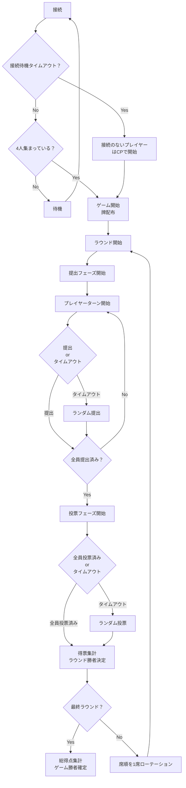

# おもじゃん（OMOJAN）オンライン版 仕様書
本ドキュメントは、4人対戦の言葉合わせゲーム「おもじゃん」のオンライン版について、ゲームの説明と実装に向けた仕様の概要を示すものです。プレイヤーの誰かが部屋（部屋名・提出制限時間・鍵の有無）を作成し4人が揃うと開始。マスタから重複なしで各7枚の手持ち牌と各ラウンド1枚のテーマ牌を抽出し、全4ラウンドを席順ローテーションで進行します。各ラウンドではテーマの前後に手札1枚で造語し（提出は部屋設定の時間内）、自分以外に1票を30秒で投票、最多得票がそのラウンド勝者、最終的に総得点トップがゲーム勝者です。匿名参加や鍵付き部屋（パスワード自動生成）に対応し、未操作・切断時は制限時間経過でランダム選択となります。

### プレイ人数・時間

- **人数**：4人
- **ラウンド数**：4ラウンド
- **持ち時間**：
  - 提出フェーズ：部屋作成時に設定
  - 投票フェーズ：30秒

### 用語

- **テーマ牌**：ラウンドのお題（文字列）
- **手持ち牌**：各プレイヤーが保持する語句（名詞・形容語幹・接頭・接尾など）
- **提出（Submission）**：`[前]ワード + テーマ` または `テーマ + [後]ワード` のいずれかで造語
- **説明（Pitch）**：最大140字の補足テキスト（任意／スコア補正なし、解釈の共有のみ）
- **投票（Vote）**：ラウンドの勝者を決めるため、自分以外の提出に**1票**

### 全体の進行
1. 任意のプレイヤーが部屋を作成する。部屋作成時は次を入力
   - 部屋名
   - 1提出の制限時間
   - 鍵をかけるか
2. 参加者を3人募集し、自分を合わせて4人集まったらゲーム開始
3. ゲーム開始時に単語のマスタから、プレイヤーあたり7枚（計28枚）の手持ち牌とラウンドあたり1枚（計4枚）のテーマ牌を抜粋し、全てかぶりがないようにする。
4. ゲームが進行し、総得点トップが勝者（同点は勝者複数）

### 1ラウンドの進行

1. **席順決定**：初回ラウンドは参加順。ラウンド毎に1席ずつずれていく。全員が1番手~4番手を経験することになる。
2. **お題提示**：テーマ牌が設定される
3. **提出フェーズ**：プレイヤーがテーマ牌との組み合わせで面白いと思う手持ち牌を1つ提出する。（前置き or 後置きを選ぶ）。 1ラウンドで全員順番に提出していく
4. **投票フェーズ**：各自が場に出た組み合わせの中から最も面白いと思うものに投票する。**自分以外**の中から1票入れる。
5. **結果**：最多得票が**ラウンド勝者**。同票は全員勝者

### その他

- プレイヤーは匿名でも参加できる。匿名の場合は、参加時、部屋作成時にプレイヤー名を入力する
- 部屋には鍵をかけることができる。鍵をかけた部屋はパスワードを入力することで参加できる。パスワードはアプリ側で自動で決められるため、ユーザーが決定することはできない。
- 提出、投票で制限時間以内に選択しなかったらランダムで選択される。途中で未接続になったユーザーは常にこの動きになる。
